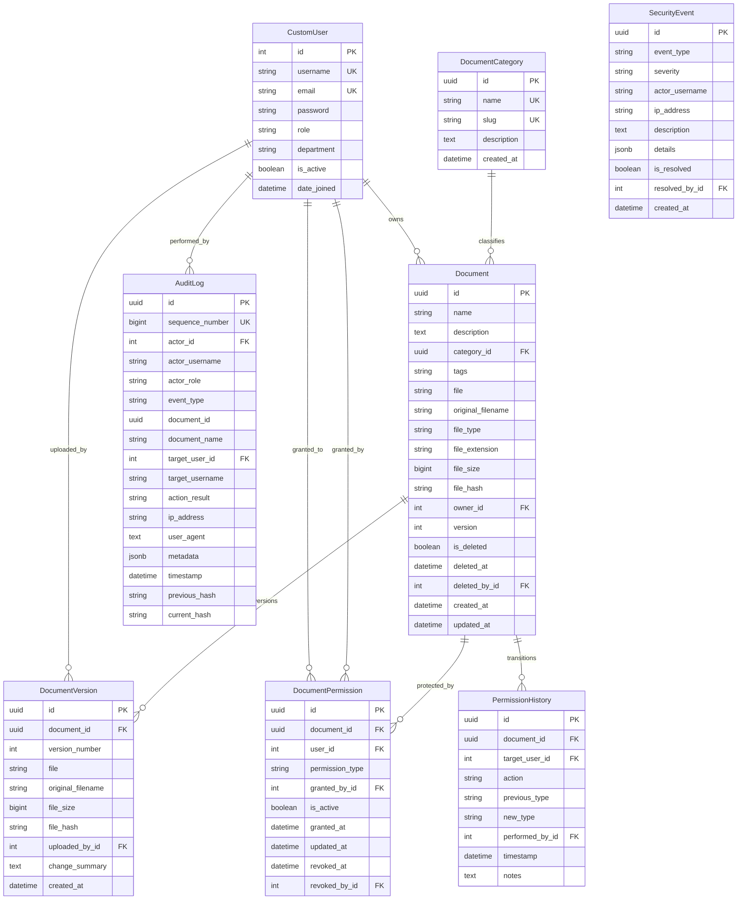

# TrustVault Database Architecture & Schema Specification (docs/DATABASE.md)

This document details the database schema, relational constraints, indexing strategies, and integrity mechanisms implemented in **TrustVault**.

---

## 1. Relational Entity-Relationship Diagram



---

## 2. Table Specifications & Constraints

### 2.1 `accounts_customuser`
- **Primary Key:** `id` (Auto-increment BigInteger).
- **Unique Constraints:**
  - `username` (VARCHAR(150), unique).
  - `email` (VARCHAR(254), unique).
- **Core Fields:**
  - `role` (VARCHAR(20)): Choices `ADMIN`, `OWNER`, `VIEWER`.
  - `department` (VARCHAR(100)).
  - `is_active` (BOOLEAN): Defaults to `True`. Deactivating instantly disables all authentication and document access across sessions.
- **Indexes:**
  - B-Tree index on `(role, is_active)`.
  - B-Tree index on `(email)`.

### 2.2 `documents_document`
- **Primary Key:** `id` (UUIDv4). Random UUIDs prevent sequential enumeration (anti-IDOR).
- **Foreign Keys:**
  - `category_id` -> `documents_documentcategory(id)` ON DELETE SET NULL.
  - `owner_id` -> `accounts_customuser(id)` ON DELETE PROTECT (prevents cascading deletion of documents if a user account is deleted).
  - `deleted_by_id` -> `accounts_customuser(id)` ON DELETE SET NULL.
- **Integrity Fields:**
  - `file_hash` (CHAR(64)): Deterministic SHA-256 fingerprint of document payload.
  - `file_size` (BIGINT): Size in bytes.
  - `version` (INTEGER): Active revision counter.
  - `is_deleted` (BOOLEAN): Soft-delete flag for retention & recovery.
- **Indexes:**
  - B-Tree composite index on `(owner_id, is_deleted)`.
  - B-Tree composite index on `(category_id, is_deleted)`.
  - B-Tree composite index on `(created_at, is_deleted)`.

### 2.3 `documents_documentversion`
- **Primary Key:** `id` (UUIDv4).
- **Foreign Keys:**
  - `document_id` -> `documents_document(id)` ON DELETE CASCADE.
  - `uploaded_by_id` -> `accounts_customuser(id)` ON DELETE PROTECT.
- **Unique Constraints:**
  - `unique_together = ('document', 'version_number')`.
- **Integrity:**
  - Each version stores independent `file_hash`, `file_size`, and `file` reference.

### 2.4 `sharing_documentpermission`
- **Primary Key:** `id` (UUIDv4).
- **Foreign Keys:**
  - `document_id` -> `documents_document(id)` ON DELETE CASCADE.
  - `user_id` -> `accounts_customuser(id)` ON DELETE CASCADE.
  - `granted_by_id` -> `accounts_customuser(id)` ON DELETE PROTECT.
  - `revoked_by_id` -> `accounts_customuser(id)` ON DELETE SET NULL.
- **Partial Unique Constraint:**
  ```python
  UniqueConstraint(
      fields=['document', 'user'],
      condition=Q(is_active=True),
      name='unique_active_permission_per_doc_user'
  )
  ```
  **Guarantee:** At most **one** active grant exists per (document, user) pair, eliminating concurrency anomalies and duplicate permissions.
- **Indexes:**
  - Composite index on `(user_id, is_active)` for ultra-fast direct permission lookups on downloads.
  - Composite index on `(document_id, is_active)`.

### 2.5 `audit_auditlog`
- **Primary Key:** `id` (UUIDv4).
- **Sequence Number:** `sequence_number` (BIGINT, UNIQUE, DB_INDEX). Monotonically increasing 1, 2, 3...
- **Cryptographic Hash Chain:**
  - `previous_hash` (CHAR(64)): Hash of record `N - 1` (Genesis record uses `0` * 64).
  - `current_hash` (CHAR(64), DB_INDEX): `SHA256(previous_hash + canonical_event_data)`.
- **Foreign Keys:**
  - `actor_id` -> `accounts_customuser(id)` ON DELETE SET NULL.
  - `target_user_id` -> `accounts_customuser(id)` ON DELETE SET NULL.
  - Note: `actor_username` and `target_username` are duplicated as VARCHAR to preserve forensic evidence even if a user account is purged.
- **Immutability Enforcement:**
  - Overridden `save()` method raises `PermissionDenied` if modifying an existing record.
  - Overridden `delete()` method raises `PermissionDenied` blocking record deletions.

---

## 3. Concurrency & Transaction Isolation

1. **Row-Level Locking:** During permission grant, change, and revocation operations, `select_for_update()` is acquired inside `transaction.atomic()`. This serializes concurrent requests and avoids lost updates.
2. **Audit Sequence Serialization:** `record_audit_event()` uses `AuditLog.objects.select_for_update().order_by('-sequence_number').first()` within an atomic transaction. This guarantees gapless, conflict-free sequence numbering and uncorrupted hash chaining under concurrent load.

---

## 4. Production Database Engine: SQLite3 (PythonAnywhere & Local)

TrustVault uses **SQLite3** as its primary production and development database:

### 4.1 SQLite3 in Production (PythonAnywhere Deployment)
- **Engine:** `django.db.backends.sqlite3`
- **File Location:** `BASE_DIR / 'db.sqlite3'` (persisted on disk)
- **Configuration:** Fully automated zero-configuration database initialized via `manage.py migrate`.
- **Security & Operational Advantages:**
  - **Zero Daemon Overhead:** Eliminates external database services, background daemon processes, TCP port exposure, and database credential management.
  - **Transactional Integrity:** SQLite's atomic write locking guarantees that audit log sequence numbering and cryptographic hash chaining are strictly serialized without race conditions.
  - **Atomic Instant Snapshots:** Full-database backups require only copying the single `db.sqlite3` file (`cp db.sqlite3 backup_$(date +%s).sqlite3`).
  - **Zero Network Attack Surface:** The database file is inaccessible over the network and only reachable by the local Python process, eliminating SQL port injection or network sniffing risks.
